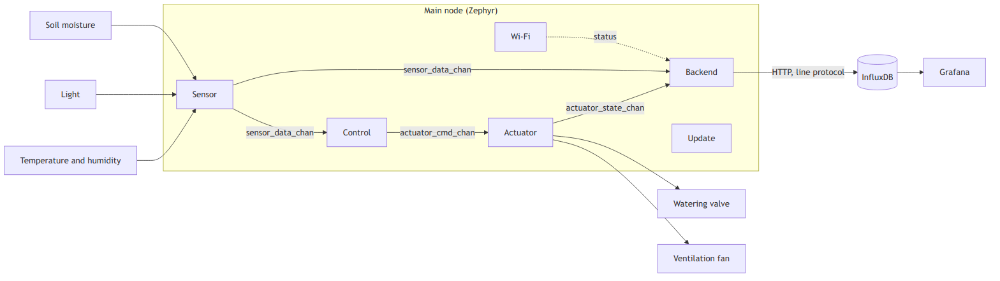
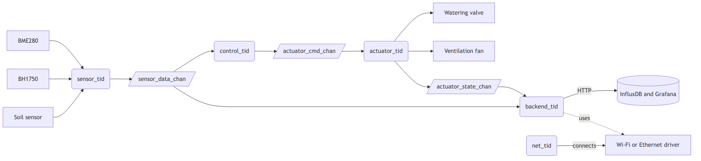
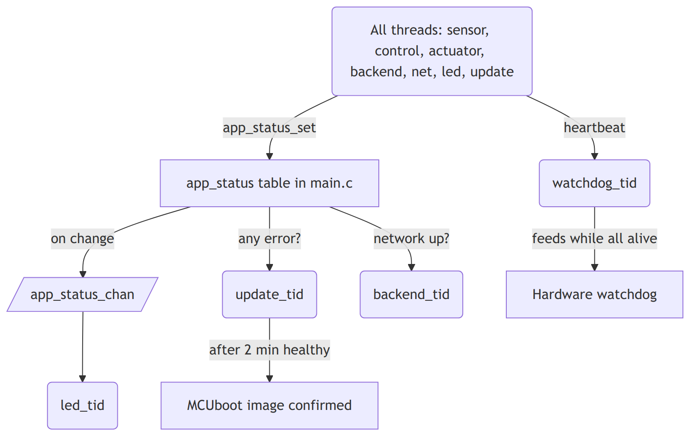

# Greenhouse controller: reference application for Zephyr

**Status:** the firmware runs on QEMU, and it builds for the XIAO ESP32C6, with and without MCUboot. **It has not yet run on real hardware.** See [What has been tested](#what-has-been-tested).

One main node measures temperature, humidity, light and soil moisture, controls watering and ventilation, and sends its data over Wi-Fi to a backend with InfluxDB and Grafana. It keeps working when the network is down.



## Cheap, easily available hardware

Any replacement that uses the same Zephyr API needs only a new overlay.

| Function | Default | Interface | Devicetree alias |
|---|---|---|---|
| Main node | Seeed Studio XIAO ESP32C6 | | |
| Temperature and humidity | BME280 | I2C | `env-sensor` |
| Light | BH1750 | I2C | `light-sensor` |
| Soil moisture | Capacitive soil moisture sensor, switched by a GPIO | ADC | `soil-sensor` |
| Watering | Relay, on/off | GPIO | `water-valve` |
| Ventilation | Relay, on/off | GPIO | `vent-fan` |

## Build options

| Target | Hardware | Network | Sensors and actuators | Updates |
|---|---|---|---|---|
| Real hardware | XIAO ESP32C6 | Wi-Fi | Real | None |
| Real hardware with updates | XIAO ESP32C6, `--sysbuild`, `update.conf` | Wi-Fi | Real | MCUboot |
| Real hardware on battery | XIAO ESP32C6, `battery.conf` | Wi-Fi, in batches | Real | None |
| **QEMU only** | `mps2/an385`, `qemu.conf` | Ethernet | Simulated | None |

Run these from your Zephyr workspace, with `<app>` as the path to this directory. Zephyr v4.4.2 is the tested version, and `west.yml` pins it.

```
# real hardware
west build -p -b xiao_esp32c6/esp32c6/hpcore --no-sysbuild <app>

# real hardware with MCUboot
west build -p -b xiao_esp32c6/esp32c6/hpcore --sysbuild <app> -- -DEXTRA_CONF_FILE=update.conf

# real hardware on battery
west build -p -b xiao_esp32c6/esp32c6/hpcore --no-sysbuild <app> -- -DEXTRA_CONF_FILE=battery.conf

# QEMU, no hardware needed
west build -p -b mps2/an385 <app> -- -DEXTRA_CONF_FILE=qemu.conf
west build -t run
```

**To switch boards:** give another board to `-b`, and add `boards/<board>.overlay` and `boards/<board>.conf` with the same aliases. Zephyr applies both automatically for that board. `-p` discards the previous build.

**To replace a sensor:** add `-DEXTRA_DTC_OVERLAY_FILE=boards/sht4x.overlay -DCONFIG_SHT4X=y`. No code changes.

`qemu.conf` turns on `CONFIG_APP_SENSOR_SIMULATE` and `CONFIG_APP_ACTUATOR_SIMULATE`, and replaces Wi-Fi with Ethernet. Simulated sensors follow a 10-minute "day", and the soil responds to the valve. Actuators only log their state.

QEMU shows the architecture, control rules, zbus channels, shell and backend upload. It does not show real power consumption, Wi-Fi or MCUboot updates.

## Wiring

| Function | XIAO pin |
|---|---|
| I2C SDA (BME280, BH1750) | D4 |
| I2C SCL (BME280, BH1750) | D5 |
| Soil sensor output | D0 |
| Soil sensor power | D3 |
| Watering relay | D8 |
| Ventilation relay | D9 |

Check these before you connect a relay:

- **Active level:** many cheap relay boards switch on when the input is low. If yours does, change the flags in the overlay to `GPIO_ACTIVE_LOW`. Otherwise it runs inverted, and the valve opens at boot.
- **Logic level:** a 5 V relay board may not switch from the XIAO's 3.3 V output.
- **During reset:** add a pull-down resistor (or a pull-up on an active-low board), so the valve stays closed while the pin floats.
- **Power:** do not power relays from the XIAO's 3.3 V pin.

## First test on the hardware

Use `west flash` and `west espressif monitor`, or your usual tools. Then, in the shell:

```
app_status
app_sensor read
app_actuator pulse fan 2
app_actuator pulse valve 2

# hold the soil sensor in dry air, then in water, and note each raw mV value
app_sensor read
app_sensor soil <dry_mv> <wet_mv>

wifi cred add -s "<SSID>" -k 1 -p "<password>"
app_backend host <your_pc_ip>
app_backend token greenhouse-local-dev-token
app_device id 0001
kernel reboot cold
```

`app_status` then shows each module as `ok`. Only a test token goes here. Use your own for anything real.

## Modules

Each module owns one thread and an `*_init()` called once at boot from `main.c`. Modules never call each other's functions. They only publish and subscribe on zbus.

| Module | File | Thread | Publishes | Subscribes |
|---|---|---|---|---|
| Sensor | `app_sensor.c` | `sensor_tid` | `sensor_data_chan` | -- |
| Control | `app_control.c` | `control_tid` | `actuator_cmd_chan` | `sensor_data_chan` |
| Actuator | `app_actuator.c` | `actuator_tid` | `actuator_state_chan` | `actuator_cmd_chan` |
| Backend | `app_backend.c` | `backend_tid` | `app_status_chan` | `sensor_data_chan`, `actuator_state_chan` |
| Network | `app_wifi.c` or `app_eth.c` | `net_tid` | `app_status_chan` | Zephyr network events |
| Update | `app_update.c` | `update_tid` | `app_status_chan` | -- (reads the status table) |
| LED | `app_led.c` | `led_tid` | -- | `app_status_chan`, with a listener |
| Watchdog | `app_watchdog.c` | `watchdog_tid` | `app_status_chan` | every module's heartbeat |

`main.c` owns no thread. It holds the `app_status` table, `init_full()` and `main()`, which starts all threads. The watchdog initialises first, so it can catch a hang in any later init.

### Threads and data

Boxes with rounded corners are threads, and the others are zbus channels. Data only moves through the channels.



### Health and supervision

Every module reports to the status table. Every thread also sends a heartbeat directly to the watchdog, which resets the device if a thread stops.



## Channels

| Channel | When | Content |
|---|---|---|
| `sensor_data_chan` | Periodic (`CONFIG_APP_SENSOR_SAMPLE_INTERVAL_MS`) | temperature, humidity, light, soil moisture, valid flags |
| `actuator_cmd_chan` | On a decision only | actuator, on/off, reason |
| `actuator_state_chan` | On an actual change | actuator, on/off, reason, duration of the last run |
| `app_status_chan` | On a health change | module, ok/error/debug |

## Control rules

Control is simple threshold logic with hysteresis. The thresholds are defaults in Kconfig, can be changed in the shell, and are kept in Settings/NVS.

- **Watering** turns on when soil moisture is below a limit, unless the light is above a limit, so it avoids watering in strong sun. It turns off above a higher moisture limit.
- **Ventilation** turns on above a temperature or air humidity limit, and off below a lower limit.
- **Safety:** watering has a maximum run time and a minimum pause.
- **After a reset or a sensor error:** the valve is off, because a stuck-open valve is the dangerous failure. The fan stays off until there is valid data.

The soil sensor is calibrated in the shell with dry and wet readings, kept in Settings/NVS. A reading below 100 mV counts as a disconnected sensor.

## Backend

The backend sends HTTP POSTs with InfluxDB line protocol directly to `/api/v2/write`, with no MQTT broker. Points wait in a queue of 64 when the network is down. After that, the oldest points are dropped and counted.

- `environment` measurement: `temperature_c`, `humidity_pct`, `light_lux`, `soil_moisture_pct`. An invalid reading is left out.
- `actuator_event` measurement: `state`, `reason`, `run_s`, with an `actuator` tag
- `device_id` tag on every point, so several greenhouses can share one backend
- Timestamps come from NTP, so that queued points keep their real time. Without NTP, InfluxDB uses the time of receipt, and points are sent one at a time so that they do not overwrite each other.

Start the local test stack from `docker/`. Grafana is on port 3000 with a ready dashboard, and InfluxDB is on port 8086:

```
docker-compose -p greenhouse up -d
```

Use `-p greenhouse` so that it stays separate from other stacks in a directory called `docker`. Set `INFLUXDB_PORT` and `GRAFANA_PORT` if those ports are taken. For QEMU, build with `-DCONFIG_APP_BACKEND_PORT=<port>` to match.

## Battery life: power management

This implements checklist items 1.1 to 1.3. All decisions below follow from Zephyr's [power management documentation](https://docs.zephyrproject.org/latest/services/pm/index.html).

| Part | Decision | Why |
|---|---|---|
| System power | `CONFIG_PM=y` in `battery.conf`, with the default residency policy. | When all threads block, the kernel enters ESP32-C6 light sleep (`standby`) if the idle time is long enough (minimum residency 2.5 ms). |
| Deep sleep | Not used. | It must be forced in software, and it loses the running state. Watering timers and the upload queue need to keep running. |
| BME280 | `CONFIG_BME280_MODE_FORCED=y`. | The sensor measures once and returns to sleep by itself. |
| BH1750 | The driver's one-time measurement mode, which is its default. | The sensor powers down after each measurement. |
| Soil sensor | Its `power-gpios` pin is on only while sampling. | It is an analog sensor that always draws current, and this also reduces corrosion. |
| Device runtime PM | `CONFIG_PM_DEVICE=y`, but no runtime calls from the application. | Zephyr leaves runtime suspend to drivers, and the ESP32 I2C and ADC drivers do not implement it. |
| Wi-Fi | Power save on (`WIFI_PS_MAX_MODEM`). In the battery build, points are also sent in batches. | The radio is the largest consumer the software controls. |
| During upload and update | `pm_policy_state_lock_get()` on `PM_STATE_STANDBY`. | Blocks sleep only while it matters. |
| Serial console | Off in `battery.conf`. | An active UART and shell work against sleep. Provision the node first with the normal build. |

Proposed defaults:

| Setting | Normal build | Battery build |
|---|---|---|
| `CONFIG_APP_SENSOR_SAMPLE_INTERVAL_MS` | 60 s | 5 min |
| `CONFIG_APP_BACKEND_UPLOAD_INTERVAL_S` | every sample | 30 min |
| `CONFIG_LOG_PROCESS_THREAD_SLEEP_MS` | 1 s (Zephyr's default) | 30 s |

The relays must stay in position during sleep, and they can use more power than everything else while they are on. A battery-powered greenhouse should use latching relays or a separate supply for the valve and the fan.

Measure current on the real board to find out what this achieves. `CONFIG_PM_STATS` counts sleep state use, but QEMU cannot show any of this.

## Maintenance: logging

This implements checklist item 2.3. The design uses the [Zephyr logging subsystem](https://docs.zephyrproject.org/latest/services/logging/index.html) so that a problem can be understood long after installation.

| Part | Decision | Why |
|---|---|---|
| Per module | `LOG_MODULE_REGISTER()` in each `app_*.c`, with a `CONFIG_APP_<MODULE>_LOG_LEVEL` from Zephyr's Kconfig template. | Each module can be examined separately. |
| Mode | `CONFIG_LOG_MODE_DEFERRED=y`. | Calls are quick and need little stack, so the CPU can sleep sooner. |
| Field debugging | `CONFIG_LOG_RUNTIME_FILTERING=y` and `CONFIG_LOG_CMDS=y`. | Raise a module's level in the shell, with no rebuild. |
| Repeated errors | `LOG_ERR_RATELIMIT()` for sensor and network errors. | A broken sensor must not flood the log or wear the flash. |
| Kept across resets | `CONFIG_LOG_BACKEND_FS=y` on a 128 KB LittleFS partition. Zephyr's default keeps 10 files of 4 KB and overwrites the oldest. | Limited retention. Info messages are rare, so flash wear stays low. Read the files in the shell with `fs`. |
| Crashes | `CONFIG_DEBUG_COREDUMP=y` with the flash partition backend. | The cause of a crash survives the reset. |
| Dictionary logging | Not used. | It saves space, but it needs an offline parser and the matching ELF file, which is a burden years later. |

**Always logged:** firmware version and reset reason at boot, every actuator change with its reason, each module's health changes, and new image confirmation. The same data does not need to go to InfluxDB: telemetry is for the greenhouse, logs are for the device.

## Updates

MCUboot is built with sysbuild, and the image is signed during the build. **The build uses MCUboot's default signing key, so generate your own before real use.** Images are uploaded over the network with mcumgr. `app_update.c` confirms a new image only after 2 minutes with no module in error. If it does not, the next reset rolls back to the previous image.

## Build-time and runtime settings

- **Build time (Kconfig, overlays):** which hardware and modules are used, including the QEMU option.
- **Runtime (shell, Settings/NVS):** Wi-Fi password, InfluxDB token and host, device ID, thresholds, soil calibration. Secrets never go in the source tree, except the test token for the local QEMU stack.

## Files

```
west.yml                 pinned Zephyr version and modules
prj.conf                 common configuration
qemu.conf, battery.conf, update.conf, sysbuild.conf
boards/
  xiao_esp32c6_esp32c6_hpcore.conf/.overlay   default hardware
  mps2_an385.overlay                          QEMU
  sht4x.overlay                               replacement sensor, shows repair
dts/bindings/            soil sensor binding
src/
  main.c                 status table, init and start
  app_shell.c            all shell commands
  app_device, app_led, app_watchdog, app_update
  app_wifi or app_eth    the network module
  app_backend            upload to InfluxDB
  app_sensor             sample loop, with app_sensor_hw or app_sensor_sim behind it
  app_control            thread, with the rules in control_logic
  app_actuator
tests/control/           unit tests of the control rules
docker/                  InfluxDB and Grafana test stack
doc/                     diagrams: .png, with the .mmd Mermaid source of each
```

## How it demonstrates the checklist

| Checklist | In this application |
|---|---|
| Reduce (1.1-1.3) | See [Battery life](#battery-life-power-management). Threads block on zbus or sleep, sensors sleep between samples, and Wi-Fi uses power save. |
| Reliability (2.1-2.3) | Modules connected only by zbus, health table, watchdog with heartbeats, local control without a network. See [Maintenance](#maintenance-logging). |
| Reliability (2.4-2.6) | Pinned `west.yml`, HTTP and open formats, and MCUboot with signed images and rollback. |
| Reuse (3.1-3.2) | Generic modules with documented headers and channels. |
| Repair (4.1-4.5) | Generic sensor and ADC APIs and Devicetree aliases. Swapping a sensor changes only an overlay. Settings survive a repair. |

The details are in the [Zephyr checklist](../../../checklists/zephyr_checklist.md).

## What has been tested

| Test | Result |
|---|---|
| Control rule unit tests on QEMU, including valve safety | 11 of 11 pass |
| QEMU: DHCP, NTP, control rules, actuator events | Works |
| QEMU to InfluxDB: real points stored, Grafana connected | Works |
| QEMU shell commands | Work |
| QEMU watchdog: `app_watchdog stop sensor` | Hang reported, then the device resets and comes back up |
| Builds for the XIAO: normal, with MCUboot, battery | Compile and link |

**Not tested, because it needs the board:**

- Sensors, ADC reading and its scale, relays, Wi-Fi and its power save, and storing settings in flash
- LittleFS logging and core dumps. The core dump partition is only 4 KB and may be too small.
- MCUboot boot, mcumgr upload and rollback
- Light sleep in `battery.conf` together with Wi-Fi and the watchdog. It may not work as it stands.
- Power consumption

